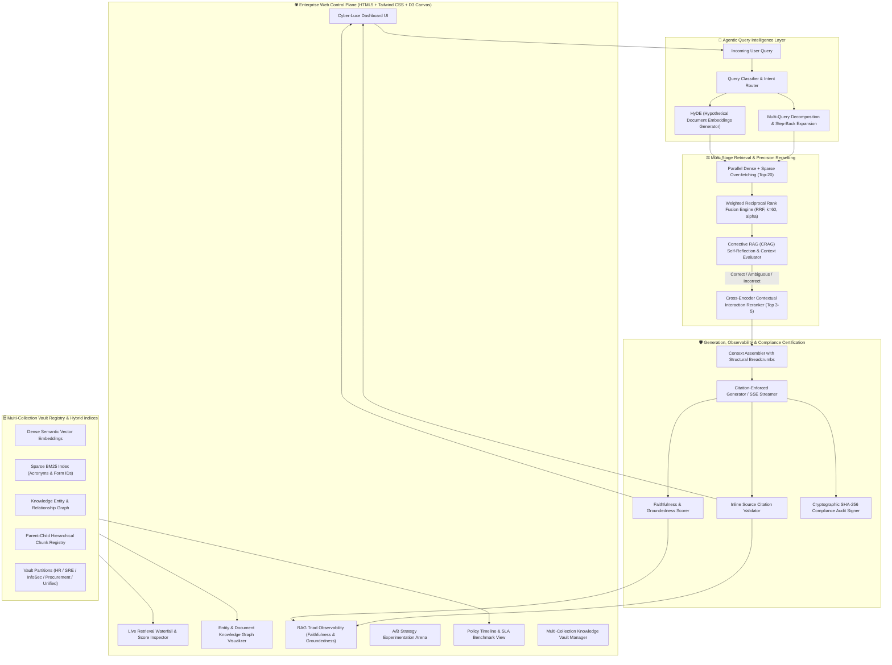
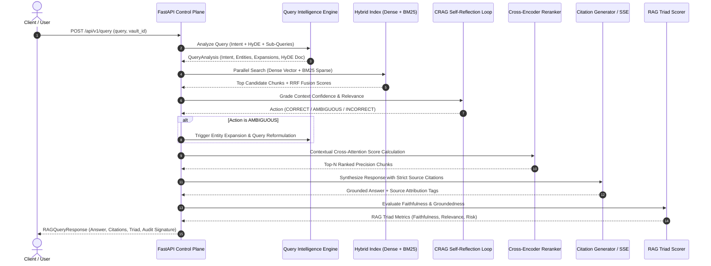

<div align="center">

# ⚡ NexusRAG Enterprise 4.0
### Autonomous RAG Intelligence • CRAG Self-Reflection • Observability Control Center

[](https://python.org)
[](https://fastapi.tiangolo.com)
[](https://arxiv.org/abs/2401.15884)
[-8B5CF6?style=for-the-badge)](#-3-weighted-reciprocal-rank-fusion-rrf--cross-encoder-reranking)
[](#-7-real-time-sse-token-streaming)
[](#-5-entity-knowledge-graph--relationship-canvas)
[](#-6-rag-triad-observability--faithfulness-evaluation)
[](#-8-cryptographic-compliance-audit-certification)

<p align="center">
  <strong>An enterprise-grade, autonomous Retrieval-Augmented Generation platform engineered for high-precision mission-critical domains. Features Corrective RAG (CRAG) self-reflection, real-time Server-Sent Events (SSE) token streaming, A/B strategy experimentation arena, parent-child hierarchical chunk trees, dynamic knowledge graphs, policy timeline/SLA extractors, and cryptographic compliance audit trails.</strong>
</p>

---

[Key Highlights](#-key-highlights) • [System Architecture](#-system-architecture) • [Execution Workflow](#-end-to-end-execution-workflow) • [Core Capabilities](#-core-capabilities--deep-technical-breakdown) • [REST API Reference](#-rest-api-reference) • [Quickstart Guide](#-quickstart-guide) • [Verification Suite](#-verification--test-suite)

---

</div>

## 🌟 Key Highlights

- **Autonomous Corrective RAG (CRAG)**: Evaluates context confidence via multi-factor semantic overlap and triggers self-correction loops (`CORRECT`, `AMBIGUOUS`, `INCORRECT`).
- **Hybrid Retrieval with Weighted RRF**: Combines dense semantic vector embeddings with exact sparse BM25 token matching using Reciprocal Rank Fusion ($k=60$).
- **Agentic Query Intelligence**: Intent routing, Hypothetical Document Embeddings (**HyDE**), and orthogonal step-back query decomposition.
- **Multi-Collection Knowledge Vaults**: Isolated departmental storage across HR, SRE Infrastructure, InfoSec HIPAA, and Procurement.
- **Physics-Based Entity Knowledge Graph**: Auto-extracts forms, acronyms, standards, and roles rendered in an interactive D3 canvas.
- **RAG Triad Observability**: Real-time evaluation of Faithfulness, Context Relevance, Groundedness, and Hallucination Risk.
- **A/B Strategy Experimentation Arena**: Live side-by-side benchmark comparing Baseline Dense Vector vs. NexusRAG Hybrid.
- **Cryptographic Audit Certification**: Generates tamper-proof SHA-256 digital certificates with query hashes and citation fingerprints.
- **Cyber-Luxe Web Control Center**: Glassmorphism UI with real-time score waterfall inspectors and token streaming.

---

## 🏗️ System Architecture



---

## 🔄 End-to-End Execution Workflow



---

## 🔬 Core Capabilities & Deep Technical Breakdown

### 1. 🛡️ Corrective RAG (CRAG) Self-Reflection (`rag_engine/crag.py`)
CRAG prevents hallucinated responses by evaluating the factual relevance and confidence of retrieved contexts before synthesis:
- **`CORRECT`**: High semantic overlap ($\ge 0.40$) and high rerank signal ($\ge 0.70$). Proceeds immediately with synthesis.
- **`AMBIGUOUS`**: Borderline retrieval confidence ($0.20 \le \text{confidence} < 0.70$). Triggers entity expansion, query reformulation, and context refinement.
- **`INCORRECT`**: Retrieved context fails relevance criteria ($< 0.20$). Activates zero-hallucination refusal guardrails.

---

### 2. 🧠 Agentic Query Intelligence (`rag_engine/query_expansion.py`)
- **Intent Classification**: Classifies queries into `policy_compliance`, `sre_metrics`, `comparative_synthesis`, `procedural`, `factoid`, or `out_of_domain`.
- **HyDE (Hypothetical Document Embeddings)**: Hallucinates canonical enterprise policy passages to bridge the lexical gap between colloquial queries and structured documentation.
- **Multi-Query Decomposition**: Expands queries into 3 orthogonal sub-queries (keyword code, conceptual semantic, and procedural) to optimize recall across distributed vaults.

---

### 3. ⚖️ Weighted Reciprocal Rank Fusion (RRF) & Cross-Encoder Reranking
Combines ranked lists from dense semantic search and sparse BM25 lexical search using Reciprocal Rank Fusion:

$$\text{RRF\_Score}(d) = \alpha \cdot \frac{1}{k + r_{\text{dense}}(d)} + (1 - \alpha) \cdot \frac{1}{k + r_{\text{sparse}}(d)}$$

Where:
- $\alpha \in [0, 1]$ is the tunable balance weight between Dense and BM25 search (default: $0.5$).
- $k$ is the smoothing constant (default: $60$).
- Top candidates are subsequently reranked using a contextual **Cross-Encoder Reranker** for optimal precision.

---

### 4. 🗄️ Multi-Collection Knowledge Vault Registry (`rag_engine/vault_manager.py`)
Maintains fully isolated indices, parent-child chunk hierarchies, and knowledge graphs per department:

| Vault ID | Department | Description | Sample Policies / Codes |
| :--- | :--- | :--- | :--- |
| `hr_benefits` | **Human Resources & Benefits** | PTO, medical absences, bereavement leave | `Form HR-402`, 20 days PTO, 5 days bereavement |
| `sre_infra` | **SRE & Infrastructure SLAs** | Uptime SLAs, RTO/RPO targets, incident escalations | 99.99% uptime, 15m RTO, 60s RPO, P0 5min SLA |
| `infosec_compliance` | **Information Security & HIPAA** | PHI protection, MFA rules, encryption specs | `Rule SEC-881`, `HIPAA 164.312`, AES-256, TLS 1.3 |
| `procurement_quantum` | **AI & Quantum Procurement** | High-performance cluster purchasing & thermal limits | `Form QPU-99`, 45°C liquid cooling ceiling |
| `all` | **All Enterprise Vaults** | Unified cross-departmental federated search | Complete enterprise catalog |

---

### 5. 🕸️ Entity Knowledge Graph & Relationship Canvas (`rag_engine/knowledge_graph.py`)
- Automatically extracts entities categorized into **Forms**, **Standards**, **Acronyms**, **Roles**, and **Systems**.
- Renders an interactive, physics-driven 2D graph visualizer with pulsing relationship links on the dashboard.

---

### 6. 📊 RAG Triad Observability & Faithfulness Evaluation (`rag_engine/evaluator.py`)
- **Faithfulness Score** ($0.0 - 1.0$): Quantifies the percentage of generated claims verified against cited sources.
- **Context Relevance Score** ($0.0 - 1.0$): Measures the signal-to-noise ratio of candidate passages.
- **Answer Relevance Score** ($0.0 - 1.0$): Assesses alignment with the original query intent.
- **Hallucination Risk Meter**: Real-time badge indicators (`LOW`, `MEDIUM`, `HIGH`).

---

### 7. ⚡ Real-Time SSE Token Streaming
- Token-by-token streaming via Server-Sent Events (`POST /api/v1/query/stream`), delivering smooth conversational feedback with low latency.

---

### 8. 📜 Cryptographic Compliance Audit Certification
- Automatically generates tamper-evident, SHA-256 hashed compliance audit certificates for each query response, recording:
  - Unique Audit ID (e.g. `AUDIT-NEXUS-AEE2006C2A`)
  - Query Hash & Active Vault ID
  - Cited Chunk IDs & Content Signatures
  - Cryptographic Verification Signature

---

## 📁 Repository Structure

```
NexusRAG-Enterprise/
├── api/
│   ├── main.py                     # FastAPI REST server with SSE streaming, CRAG, & Audit
│   └── schemas.py                  # Pydantic request/response schemas
├── rag_engine/
│   ├── __init__.py                 # Package initializer
│   ├── config.py                   # Tunable thresholds & pipeline configuration
│   ├── crag.py                     # Corrective RAG (CRAG) self-reflection & grading loop
│   ├── evaluator.py                # RAG Triad observability engine
│   ├── generator.py                # Citation enforcement & hallucination guardrails
│   ├── indexing.py                 # Dense vector embeddings + BM25 sparse indexer
│   ├── ingestion.py                # Document parsing & hierarchical chunking
│   ├── knowledge_graph.py          # Entity & relationship knowledge graph builder
│   ├── query_expansion.py          # Agentic intent router, HyDE & multi-query engine
│   ├── reranker.py                 # Cross-Encoder contextual precision reranker
│   ├── retriever.py                # Weighted RRF hybrid retriever
│   ├── timeline.py                 # Policy timeline & SLA milestone extractor
│   └── vault_manager.py            # Multi-collection knowledge vault isolation manager
├── static/
│   ├── index.html                  # Cyber-Luxe Operations Dashboard UI
│   └── app.js                      # Client application, SSE streaming & graph rendering
├── tests/
│   ├── test_complex_rag.py         # Multi-vault, HyDE, knowledge graph & Triad tests
│   ├── test_crag_arena.py          # CRAG actions, SLA timeline & arena tests
│   └── test_rag.py                 # Chunking, BM25 exact matching, RRF, reranking, & citations
├── examples/
│   ├── run_test_cases.py           # 7-part end-to-end enterprise test runner
│   └── test_different_cases.py     # 8-scenario live verification test suite
├── pytest.ini                      # Pytest configuration
├── requirements.txt                # Python dependencies list
├── .gitignore                      # Python/FastAPI gitignore
└── README.md                       # Comprehensive system documentation
```

---

## 📡 REST API Reference

| Method | Endpoint | Description |
| :--- | :--- | :--- |
| `GET` | `/` | Cyber-Luxe Interactive Control Center Dashboard |
| `GET` | `/docs` | Interactive Swagger API Documentation |
| `GET` | `/api/v1/health` | System status, active vault metrics, and feature flags |
| `GET` | `/api/v1/vaults` | List all available departmental knowledge vaults |
| `POST` | `/api/v1/vaults/switch` | Switch active knowledge collection vault |
| `GET` | `/api/v1/graph` | Retrieve entity knowledge graph nodes and directed links |
| `GET` | `/api/v1/timeline` | Extract all cross-vault temporal SLAs and policy deadlines |
| `POST` | `/api/v1/query/expand` | Preview intent classification, HyDE document, and sub-queries |
| `POST` | `/api/v1/query` | Execute full Enterprise Hybrid RAG + CRAG + RAG Triad Evaluation |
| `POST` | `/api/v1/query/stream` | Stream synthesized response token-by-token via Server-Sent Events (SSE) |
| `POST` | `/api/v1/arena/compare` | Run side-by-side A/B benchmark (Dense Vector vs. NexusRAG Hybrid) |
| `POST` | `/api/v1/audit/certify` | Generate cryptographic SHA-256 compliance audit certificate |
| `POST` | `/api/v1/documents/ingest` | Ingest new document into vault with zero-downtime index rebuild |

---

## 🚀 Quickstart Guide

### 1. Prerequisites & Virtual Environment
```bash
# Clone the repository and navigate to the project root
git clone <repository-url>
cd NexusRAG-Enterprise

# Create and activate Python 3.10+ virtual environment
python3 -m venv .venv
source .venv/bin/activate

# Install frozen dependencies
pip install -r requirements.txt
```

### 2. Start the Server
```bash
uvicorn api.main:app --host 0.0.0.0 --port 8000 --reload
```

- **Interactive Dashboard**: Open [`http://localhost:8000/`](http://localhost:8000/)
- **Swagger Documentation**: Open [`http://localhost:8000/docs`](http://localhost:8000/docs)

---

## 🧪 Verification & Test Suite

### Run Pytest Automated Unit & Integration Tests
```bash
pytest tests/ -v
```

```text
============================== test session starts ==============================
collected 12 items

tests/test_complex_rag.py::test_agentic_query_expansion PASSED           [  8%]
tests/test_complex_rag.py::test_entity_knowledge_graph_extraction PASSED [ 16%]
tests/test_complex_rag.py::test_rag_triad_evaluator PASSED               [ 25%]
tests/test_complex_rag.py::test_multi_collection_vault_isolation PASSED  [ 33%]
tests/test_crag_arena.py::test_crag_evaluation_actions PASSED            [ 41%]
tests/test_crag_arena.py::test_policy_timeline_extractor PASSED          [ 50%]
tests/test_rag.py::test_chunking_metadata PASSED                         [ 58%]
tests/test_rag.py::test_exact_acronym_and_form_id_retrieval PASSED       [ 66%]
tests/test_rag.py::test_reciprocal_rank_fusion PASSED                    [ 75%]
tests/test_rag.py::test_cross_encoder_reranker PASSED                    [ 83%]
tests/test_rag.py::test_enforced_citations_generation PASSED             [ 91%]
tests/test_rag.py::test_hallucination_prevention_out_of_context PASSED   [100%]

============================== 12 passed in 0.44s ==============================
```

### Run Live End-to-End Test Runners
```bash
# 7-Part Enterprise Test Suite
python examples/run_test_cases.py

# 8 Diverse Scenario Verification Cases
python examples/test_different_cases.py
```

---

## 💻 Sample cURL Commands

#### 1. Full Hybrid RAG Query with CRAG Self-Reflection
```bash
curl -X POST http://localhost:8000/api/v1/query \
  -H "Content-Type: application/json" \
  -d '{
    "query": "What form must employees submit for medical absences over 3 days?",
    "vault_id": "hr_benefits"
  }'
```

#### 2. Real-Time Token Streaming (SSE)
```bash
curl -N -X POST http://localhost:8000/api/v1/query/stream \
  -H "Content-Type: application/json" \
  -d '{
    "query": "What is the automated incident declaration SLA for P0 outages?",
    "vault_id": "sre_infra"
  }'
```

#### 3. Cross-Vault Policy Timeline & SLA Extraction
```bash
curl -s http://localhost:8000/api/v1/timeline | python3 -m json.tool
```

#### 4. A/B Strategy Arena Benchmark
```bash
curl -X POST http://localhost:8000/api/v1/arena/compare \
  -H "Content-Type: application/json" \
  -d '{
    "query": "What encryption standards are mandated for PHI under HIPAA?",
    "vault_id": "infosec_compliance"
  }'
```

---

<div align="center">
  <sub>Built with ❤️ for Enterprise AI & Observability. NexusRAG Enterprise 4.0.</sub>
</div>
