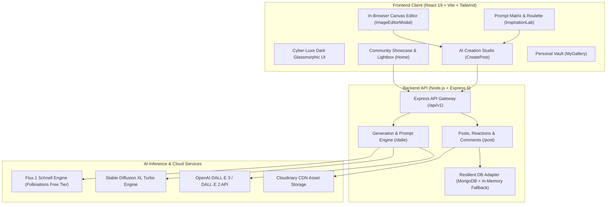
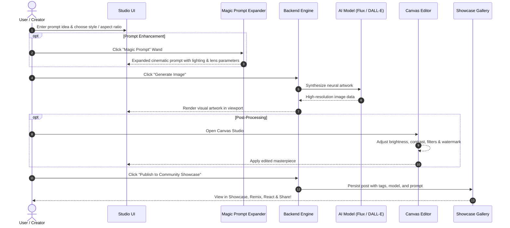

# 🌌 AetherArt AI Creative Studio & Community Platform 2.0

<div align="center">


**A next-generation AI image generation, prompt engineering laboratory, post-processing canvas studio, and community showcase platform.**

[Features](#-key-features--innovations) • [Architecture](#-system-architecture) • [User Flow](#-user-workflow) • [API Reference](#-api-reference) • [Quickstart](#-quickstart-guide)

</div>

---

## 🏗️ System Architecture



---

## 🔄 User Workflow



---

## ✨ Key Features & Innovations

### 1. 🚀 Multi-Engine AI Generation Hub
- **Flux.1 Schnell**: High-speed, ultra-HD visual generation without mandatory API keys.
- **Stable Diffusion XL Turbo**: Detailed text-to-image synthesis with rapid latency.
- **OpenAI DALL·E 3 & DALL·E 2**: Photorealistic visual creation with customizable quality (`Standard`, `HD`) and styles (`Vivid`, `Natural`).
- **Flexible Aspect Ratios**: Choose from `1:1 Square`, `16:9 Landscape`, `9:16 Portrait/Story`, `4:3 Classic`, and `21:9 Ultrawide`.
- **Advanced Optics & Lighting**: Customizable sliders and modifiers for volumetric god rays, cyberpunk neon, golden hour, 85mm portrait lenses, 35mm film grain, drone aerial views, and negative prompt filtering.

### 2. 🪄 Prompt Engineering Lab & "Magic Prompt" Enhancer
- **Magic Wand Auto-Enhancer**: 1-click automatic transformation of basic ideas into rich, cinematic, photorealistic prompt recipes with lighting, camera angles, and rendering tokens.
- **Interactive Prompt Matrix Composer**: Modular block-by-block prompt builder (*Hero Subject* + *Environment* + *Style* + *Lighting* + *Lens*).
- **Prompt Roulette Machine**: Randomized slot-machine prompt inspiration generator with particle confetti.
- **Curated Prompt Decks**: Battle-tested prompt recipes categorized by *Sci-Fi*, *Dark Fantasy*, *3D Pixar*, *Anime/Ghibli*, *Characters*, and *Architecture*.

### 3. 🎨 In-Browser AI Canvas & Post-Processing Studio
- **Color Grading & Adjustments**: Real-time canvas sliders for Brightness, Contrast, Vibrance/Saturation, Sepia/Warmth, Hue Rotation, and Blur.
- **Visual Filter Presets**: *Cyberpunk Neon*, *Vintage 80s*, *Dramatic Noir*, *Golden Sunset*, and *Vivid HDR*.
- **Custom Watermark Tool**: Add custom signatures or brand watermarks with position controls.
- **2x Super-Resolution Simulation**: Canvas bicubic sharpening and upscaling.
- **Multi-Format Exporter**: Export creations in **PNG HD**, **JPG**, or **WebP**.

### 4. 🌟 Community Showcase & Social Discovery 2.0
- **1-Click Prompt Remixing**: Fork any community creation's prompt, model, style, and aspect ratio directly into your Creation Studio to iterate on it.
- **High-Resolution Lightbox Modal**: Zoomable image inspector with full metadata drawer (model badge, prompt, aspect ratio, style tags, seed, creation date).
- **Interactive Likes & Community Vibes**: Emoji vibe reactions (🔥, 🚀, ❤️, 🤯) and like counter.
- **Interactive Comment Feed**: Leave real-time feedback and discussion on community posts.
- **Advanced Filtering & Sorting**: Filter by category/style pills or sort by *Newest*, *Most Liked*, or *Oldest*.

### 5. 🔒 Personal Vault (My Gallery)
- **Saved Favorites**: Direct access to all bookmarked community artworks in local storage.
- **Session Generation History**: Review, compare, remix, or download any artwork generated in your session.

### 6. 💎 Cyber-Luxe Dark Glassmorphism UI
- Frosted glass panels (`backdrop-blur-xl`), animated neon gradients, fluid micro-interactions, responsive mobile sub-navigation, and toast notifications.

---

## 📁 Project Directory Structure

```
Image-Generation-Using-AI/
├── AI_Image_Generation/
│   ├── BackEnd/
│   │   ├── index.js                  # Express server entry point & health check
│   │   ├── package.json              # Backend dependencies
│   │   ├── mongodb/
│   │   │   ├── connect.js            # MongoDB connection handler
│   │   │   └── models/
│   │   │       └── post.js           # Mongoose schema (model, style, tags, likes, comments)
│   │   └── routes/
│   │       ├── dalleRoutes.js        # Multi-model AI generation & prompt enhancer endpoint
│   │       └── postRoutes.js         # Community posts CRUD, like toggle & comments
│   └── FrontEnd/
│       ├── index.html                # App root HTML with Google Fonts & metadata
│       ├── package.json              # Frontend dependencies
│       ├── vite.config.js            # Vite configuration
│       ├── tailwind.config.js        # Tailwind styling tokens
│       └── src/
│           ├── App.jsx               # Navigation header, router & settings modal
│           ├── index.css             # Glassmorphism design system & neon styling
│           ├── main.jsx              # React DOM entry
│           ├── assets/               # Icons & fallback assets
│           ├── constants/            # Style presets, aspect ratios, prompt templates & demo data
│           ├── utils/                # Prompt enhancer, storage helpers, canvas exporter
│           ├── components/
│           │   ├── Card.jsx          # Glassmorphic community showcase card
│           │   ├── FormField.jsx     # Input field with Magic Prompt & Surprise Me
│           │   ├── Loader.jsx        # Neon glowing AI loading indicator
│           │   ├── LightboxModal.jsx # High-res zoomable modal with metadata & comments
│           │   ├── ImageEditorModal.jsx # Canvas post-processing editor
│           │   ├── ApiSettingsModal.jsx # Engine settings & API key manager
│           │   └── Toast.jsx         # Toast notification provider
│           └── pages/
│               ├── Home.jsx          # Community Showcase 2.0 with search & category pills
│               ├── CreatePost.jsx    # AI Creation Studio with multi-model controls
│               ├── InspirationLab.jsx# Prompt matrix composer & prompt roulette
│               └── MyGallery.jsx     # Personal favorites & generation history vault
└── README.md                         # Project documentation
```

---

## 📡 API Reference

| Method | Endpoint | Description | Request Body / Query Params |
| :--- | :--- | :--- | :--- |
| `GET` | `/` | Health check & system status | `None` |
| `GET` | `/api/v1/dalle` | Engine capabilities & supported models | `None` |
| `POST` | `/api/v1/dalle` | Generate image with AI engine | `{ prompt, model, size, width, height, customApiKey, seed }` |
| `POST` | `/api/v1/dalle/enhance-prompt` | AI Prompt expander | `{ prompt, styleName, lighting, camera }` |
| `GET` | `/api/v1/post` | Fetch community showcase posts | `?search=...&style=...&sortBy=latest\|popular` |
| `POST` | `/api/v1/post` | Publish new artwork to showcase | `{ name, prompt, photo, model, style, aspectRatio, tags }` |
| `PATCH` | `/api/v1/post/:id/like` | Toggle like counter | `{ action: "like" \| "unlike" }` |
| `POST` | `/api/v1/post/:id/comment` | Append comment to post | `{ user, text }` |

---

## 🚀 Quickstart Guide

### Prerequisites
- **Node.js** v18+ installed.
- **npm** or **yarn**.

### 1. Start Backend Server
```bash
cd AI_Image_Generation/BackEnd
npm install
npm start
```
> Server starts on [`http://localhost:8080`](http://localhost:8080).

### 2. Start Frontend Client
```bash
cd AI_Image_Generation/FrontEnd
npm install
npm run dev
```
> Client starts on [`http://localhost:5173`](http://localhost:5173).

---

## ⚙️ Environment Variables (Optional)

Create a `.env` file in `AI_Image_Generation/BackEnd/`:

```env
PORT=8080
MONGODB_URL=mongodb+srv://<username>:<password>@cluster.mongodb.net/aetherart
CLOUDINARY_CLOUD_NAME=your_cloudinary_name
CLOUDINARY_API_KEY=your_cloudinary_key
CLOUDINARY_API_SECRET=your_cloudinary_secret
OPENAI_API_KEY=sk-...
```

> 🛡️ **Zero-Config Resilient Fallback**: If MongoDB, Cloudinary, or OpenAI API keys are not provided, the platform automatically utilizes its high-speed in-memory store and fast Flux.1/SDXL engine so the entire studio works out of the box!

---

## 📄 License

This project is open-source and available under the [ISC License](LICENSE).
