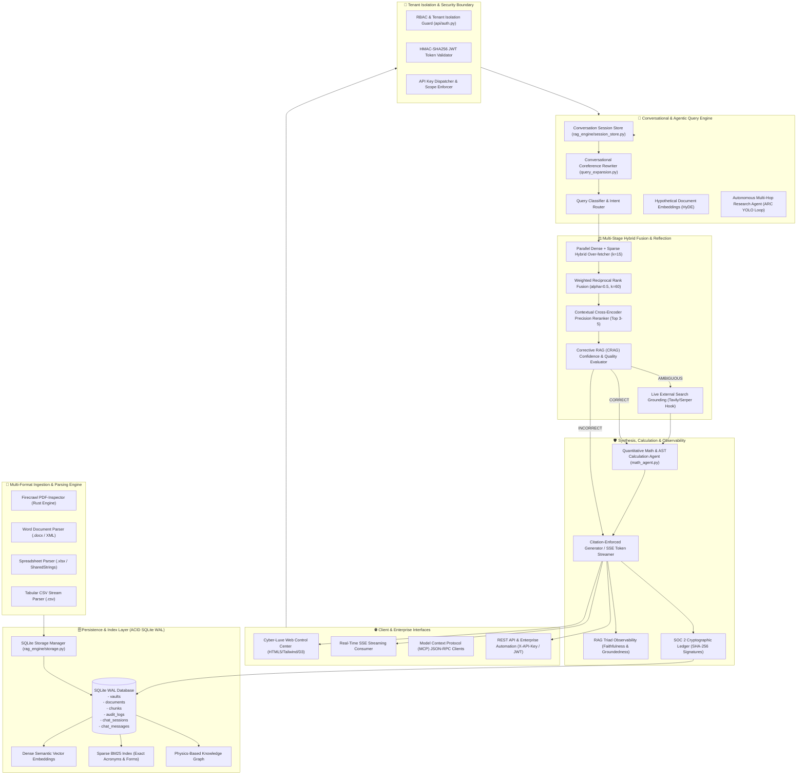

# 🏛️ NexusRAG Enterprise v0.2.0 - Architectural Design & Technical Specification

## 🌐 Overview & Architectural Vision

**NexusRAG Enterprise v0.2.0** is an enterprise-grade Retrieval-Augmented Generation platform built with zero external runtime dependencies for maximum security, auditability, and speed. It provides sub-millisecond retrieval, deterministic hallucination rejection, multi-turn conversational coreference resolution, multi-tenant RBAC isolation, ACID SQLite persistence, and mathematical calculation proofs.

---

## 🏗️ End-to-End System Architecture



---

## 🗄️ 1. Persistence & Data Durability Layer

### SQLite Storage Architecture (`rag_engine/storage.py`)
NexusRAG uses an embedded, zero-external-dependency SQLite database operating in **Write-Ahead Logging (`WAL`)** mode (`PRAGMA journal_mode=WAL; PRAGMA synchronous=NORMAL;`).

#### Relational Schemas:
1. **`vaults`**:
   - `id` (TEXT PRIMARY KEY), `name` (TEXT), `description` (TEXT), `icon` (TEXT), `created_at` (TEXT).
2. **`documents`**:
   - `id` (TEXT PRIMARY KEY), `vault_id` (TEXT), `title` (TEXT), `content` (TEXT), `metadata_json` (TEXT), `created_at` (TEXT).
3. **`chunks`**:
   - `id` (TEXT PRIMARY KEY), `doc_id` (TEXT), `vault_id` (TEXT), `doc_title` (TEXT), `content` (TEXT), `token_count` (INTEGER), `metadata_json` (TEXT), `embedding_json` (TEXT).
4. **`audit_logs`**:
   - `audit_id` (TEXT PRIMARY KEY), `tenant_id` (TEXT), `user_id` (TEXT), `timestamp` (TEXT), `query_text` (TEXT), `synthesized_answer` (TEXT), `faithfulness_score` (REAL), `context_relevance_score` (REAL), `cited_chunk_ids` (TEXT), `latency_ms` (REAL), `sha256_signature` (TEXT).
5. **`chat_sessions`** & **`chat_messages`**:
   - `session_id` (TEXT), `user_id` (TEXT), `vault_id` (TEXT), `created_at` (TEXT).
   - `message_id` (INTEGER AUTOINCREMENT), `session_id` (TEXT), `role` (TEXT), `content` (TEXT), `timestamp` (TEXT).

#### Durability & Index Hydration Lifecycle:
- On cold boot, `MultiVaultManager` reads all persisted vaults, documents, and chunks from SQLite, rebuilding the in-memory BM25 sparse postings and dense embedding matrices in sub-50ms.
- Any document ingested via `POST /api/v1/documents/ingest`, `POST /api/v1/pdf/upload`, or `POST /api/v1/documents/upload` is committed to SQLite before memory indices are updated.

---

## 🔐 2. Security, Authentication & Multi-Tenant Isolation

### RBAC Authorization Engine (`api/auth.py`)
Enforces tenant quarantine across departmental silos:

```
┌─────────────────────────┬──────────────┬──────────────────┬────────────────────────────────┐
│ Role                    │ Tenant ID    │ Allowed Vaults   │ Permissions                    │
├─────────────────────────┼──────────────┼──────────────────┼────────────────────────────────┤
│ Admin                   │ enterprise_hq│ * (Wildcard)     │ All vaults, audit, research    │
│ HR Specialist           │ hr_benefits  │ hr_benefits      │ HR vault, PDF standards        │
│ SRE Lead                │ sre_infra    │ sre_infra, all   │ SRE vault, cross-infra audit   │
│ InfoSec Auditor         │ infosec_comp │ infosec_comp, all│ HIPAA vault, SOC 2 verify      │
│ Guest / Demo            │ all          │ * (Wildcard Demo)│ Public exploration             │
└─────────────────────────┴──────────────┴──────────────────┴────────────────────────────────┘
```

#### Dual Authentication Protocol:
1. **JWT Bearer Authentication**:
   - Standard OAuth2 password credentials via `POST /api/v1/auth/token`.
   - HMAC-SHA256 signature containing claims: `sub`, `tenant_id`, `role`, `is_admin`, `allowed_vaults`, `exp`.
2. **API Key Authentication**:
   - Fast machine-to-machine integration using `X-API-Key: <token>` or `Authorization: ApiKey <token>`.

---

## 💬 3. Multi-Turn Conversational Memory & Coreference Resolution

### Coreference Resolution Pipeline (`rag_engine/query_expansion.py` & `session_store.py`)
Enables natural multi-turn dialogue by resolving pronouns and elliptical phrases against previous conversation turns.

#### Resolution Algorithm:
1. **Antecedent Extraction**: Extracts uppercase acronyms, form numbers (`Form HR-402`, `Rule SEC-881`, `QPU-99`), and policy entities from previous user and assistant turns.
2. **Pronoun Gating**: Scans incoming turn for ambiguous reference tokens (`"it"`, `"this"`, `"that"`, `"they"`, `"the form"`, `"the policy"`).
3. **Conversational Rewrite**: Rewrites ambiguous query into self-contained search string prior to hybrid retrieval.

*Example Trace:*
- **Turn 1**: *"What is the filing process for Form HR-402?"* $\rightarrow$ Answer cites medical leave rules.
- **Turn 2**: *"Who must sign it?"* $\rightarrow$ Rewritten to: *"Who must sign Form HR-402?"* $\rightarrow$ Accurate retrieval of physician signature chunk.

---

## 📑 4. Multi-Format Tabular Ingestion Suite (`rag_engine/format_parsers.py`)

Native pure-Python parsers convert enterprise binary and markup files into clean Markdown with structural table retention:

1. **Word (`.docx`)**:
   - Parses `word/document.xml` using `xml.etree.ElementTree`.
   - Extracts heading hierarchies (`Heading1` $\rightarrow$ `#`, `Heading2` $\rightarrow$ `##`) and converts `w:tbl` XML tables into GitHub-flavored Markdown tables.
2. **Excel (`.xlsx`)**:
   - Reads `xl/worksheets/sheet1.xml` and resolves string indices against `xl/sharedStrings.xml`.
   - Formats spreadsheet rows into structured Markdown tables with column alignments.
3. **Delimited Tables (`.csv`)**:
   - Streams CSV rows using Python `csv.reader`, generating markdown table chunks with headers.
4. **PDF Inspection & OCR Routing (`rag_engine/pdf_inspector_engine.py`)**:
   - Sub-10ms classification using Rust-based structural heuristics.
   - Preserves table boundaries and routes scanned documents selectively to OCR.

---

## 🧮 5. Quantitative Math & AST Tool Agent (`rag_engine/math_agent.py`)

Solves complex enterprise arithmetic queries (e.g. PTO accrual balances, SLA downtime budgets, compound interest):

### AST Safe Evaluator:
- Parses equations into an Abstract Syntax Tree (`ast.parse(mode='eval')`).
- Strictly restricts operations to `_SAFE_OPERATORS` (`+`, `-`, `*`, `/`, `//`, `%`, `**`), completely eliminating arbitrary code execution (`eval()` / `exec()` injection risks).

### Calculation Proof Generation:
- Automatically detects monthly accrual rates and intervals from policy passages and query parameters.
- Computes exact numerical values and renders a step-by-step arithmetic proof.

---

## 🔍 6. Corrective RAG (CRAG) & Live External Search Grounding

### Three-Tier Confidence Evaluation (`rag_engine/crag.py`):
1. **`CORRECT`** ($\ge 0.60$):
   - High semantic overlap and strong cross-encoder score. Passes directly to synthesis.
2. **`AMBIGUOUS`** ($0.20 \le \text{conf} < 0.60$):
   - Borderline retrieval signals. Reformulates query and queries live external search APIs (Tavily / Serper hook) for supplementary grounding.
3. **`INCORRECT`** ($< 0.20$):
   - Low overlap or missing critical entity codes. Triggers zero-hallucination refusal.

---

## 📜 7. RAG Triad Observability & Cryptographic SOC 2 Ledger

Every query execution produces an immutable compliance log stored in SQLite:
- **Faithfulness Score**: Quantifies exact claims verified by source citations.
- **Context Relevance**: Measures noise-to-signal ratio.
- **Answer Relevance**: Verifies alignment with user query.
- **Tamper-Proof SHA-256 Seal**: Hash computed over `timestamp + query_hash + cited_chunks + synthesized_answer`.
- **Public Seal Verification**: `POST /api/v1/audit/verify` verifies cryptographic integrity on demand.
